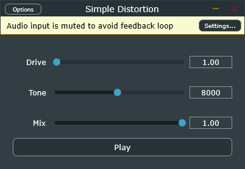

# Simple Distortion

A minimal distortion effect plugin (VST3 + Standalone) built with C++17 and JUCE 8.0.4. It is a small learning project, designed to be easy to read and explain.

## How it works

Each sample goes through this chain, per channel:

1. Input plus an optional built-in test tone (a sine at 220 Hz).
2. Drive: the signal is multiplied by a gain from 1 to 20.
3. Soft clipping with `std::tanh`.
4. Tone: a one-pole low-pass filter, with a cutoff from 500 to 16000 Hz.
5. Mix: a blend between the original signal and the distorted one.

The distortion itself is memoryless: every sample is processed on its own. The Tone filter is the only part with state, because it remembers its previous output (one filter per channel).

## Parameters

- Drive: pre-gain, linear, 1x to 20x.
- Tone: low-pass cutoff, 500 Hz to 16 kHz (linear slider).
- Mix: 0% is the dry signal only, 100% is the distorted signal only.
- Play/Stop: turns the built-in test tone on and off, so the Standalone can be tested without a DAW or a microphone.

## Build (Windows)

Requirements: Visual Studio with the C++ tools, and CMake 3.22 or newer. JUCE is downloaded automatically with FetchContent.

Open a Developer Command Prompt for VS and run:

    cmake -B build
    cmake --build build --config Debug

The Standalone app is created at:

    build\SimpleDistortion_artefacts\Debug\Standalone\Simple Distortion.exe

## Hearing safety

A high Drive makes the output much louder. Use headphones with a low volume, start with Drive at 1, and mute the audio input in the Standalone options to avoid microphone feedback.

## Known limitations

- Aliasing: there is no oversampling, and the naive oscillator is not band-limited.
- Parameters are plain `std::atomic<float>` values, with no AudioProcessorValueTreeState. The host cannot see or automate them, and the plugin state is not saved.
- No parameter smoothing, so moving Drive or Tone quickly can cause clicks.
- No output level compensation: the volume changes with Drive.
- The filter is a one-pole (6 dB per octave).
- The Tone slider is linear, so most of the audible change is squeezed to the left.
- No automated tests.

## License

Built with JUCE. Check the JUCE license terms before distributing binaries.